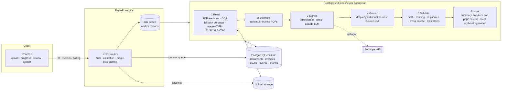

# Architecture

## Request lifecycle
1. `POST /api/documents` streams each file to disk (size-capped), checks extension **and** magic bytes, stores it under a random name, inserts a `documents` row (`queued`) and returns immediately.
2. A worker picks up the id. Every stage commits progress + an audit event, so the UI can poll and a crash loses nothing: on restart, `queued`/`processing` rows are re-queued.
3. Reading: digital PDFs use the text layer (rebuilt into table-preserving lines); pages with < 30 characters are rendered and OCR'd (OpenCV deskew, denoising only when the first read is weak, Tesseract) in a bounded thread pool, 8 pages at a time, so a 1000-page scan never holds more than a few page images in memory. One unreadable page is recorded and does not fail the file.
4. A PDF is split into invoices wherever the invoice number changes. Spreadsheets: header row detection, column aliasing, rows grouped into invoices with line items; free-form sheets go through the text extractor.
5. Extraction produces fields + per-field confidence. LLM output is schema-checked and **grounded**: a value that cannot be found in the source text is set to `null`, never kept.
6. Validation (see README) runs under a lock so duplicate detection is deterministic with concurrent workers; the earliest record is the original.
7. Page text, an invoice summary line and a line-items line are embedded with a local ONNX model (`fastembed`) and stored for semantic search.

## Key decisions
| Decision | Why | Alternative at larger scale |
|---|---|---|
| FastAPI + Python worker threads | OCR/ML stack is Python; avoids a cross-language hop | Celery/RQ/BullMQ consumers calling the same `process_document(id)` |
| State in DB, queue is in-memory | No Redis to operate; crash-safe by re-queueing from DB | Redis queue for multi-node |
| Rules **and** LLM, grounded | Works offline and in tests; LLM adds recall on messy layouts; grounding guarantees no invented values | Layout-aware models (e.g. donut/LayoutLM) fine-tuned on the company's invoices |
| Embeddings in the same DB (numpy cosine) | One datastore, fine to ~10^5 chunks | pgvector or Qdrant |
| `fastembed` ONNX model baked into the image | Meaning-based search with no PyTorch and no network at runtime | A hosted embedding API, or a larger model |
| Flag look-alike OCR readings, repair only on batch evidence | A wrong number that looks right is worse than one a person checks | Supplier-level numbering patterns learnt across files |
| Float amounts with 0.02 tolerance | Simple; validation tolerates rounding | `NUMERIC(14,2)` / integer minor units |
